# 05 - Create and Check Briefings

In this chapter you will produce a FAQ and audio overview, then check claims against the source pack.

> **Prompts:** the [prompts page](./prompts.md) has every value and prompt for this chapter, each with a Copy button.

**Estimated time:** 50 minutes, planned as 10 explanation and demonstration, 20 guided build and casework, 15 independent practice and 5 verification and repair, with 40 active minutes by design. Not yet timed with learners.

**Your result:** A checked FAQ and reviewed audio briefing or recorded feature limitation.

> **Status:** partial author reference with 11 staged captures. FAQ checked, written briefing saved and Brief audio generated; full listening and timestamped claim audit remain pending. Independent challenge, human review and classroom timing remain pending.

---

## What You Will Learn

- Create a source-supported FAQ.
- Generate and review an audio overview.
- Record corrections and gaps.

## Before You Begin

Read the [case input](./prompts.md) and use a separate named casework copy for destructive tests or altered datasets. Keep the baseline unchanged for later chapters. Record source facts, proposed practice and unresolved questions separately.

Use the evidence notebook with the three processed sources. Audio generation availability and limits vary; use a trainer demonstration if unavailable.

## 5.1 Build a Checked FAQ

1. In the evidence notebook, keep only S1–S3 selected and request exactly five FAQ entries covering purpose/duration, teams, cadence/success, budget and unresolved decisions. Use the five-entry FAQ prompt in Part 3 of the [prompts page](./prompts.md).

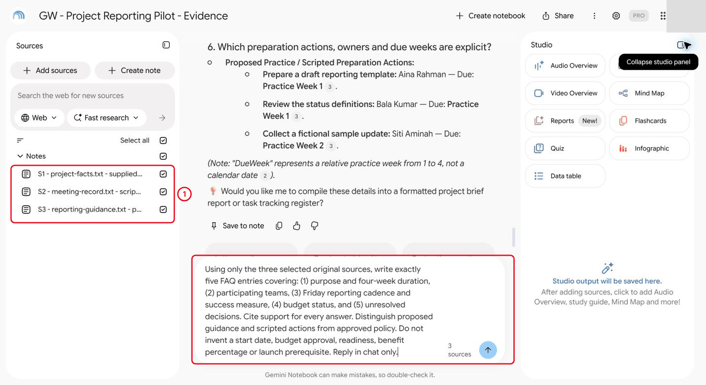

*Only the three original sources are selected.*

2. Check each answer against its original passage. For the explicit no-purchase-authorisation statement, use S2; S1 provides scope context rather than that exact statement.

> **Reference run:** The author response retained the required facts, but the question framed decisions as conditions “before the pilot can start.” Record the open decisions without inferring a formal launch gate.

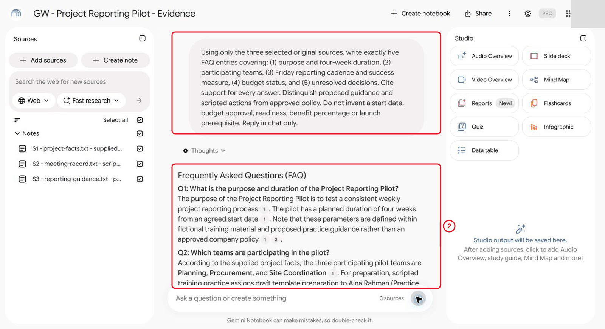

*Check each answer against its cited passage.*

3. Open the cited fact sheet, scripted meeting record and proposed guidance. Read the surrounding text, not only the citation marker.

> **Reference run:** The author checked all five retained answers against those original bodies.

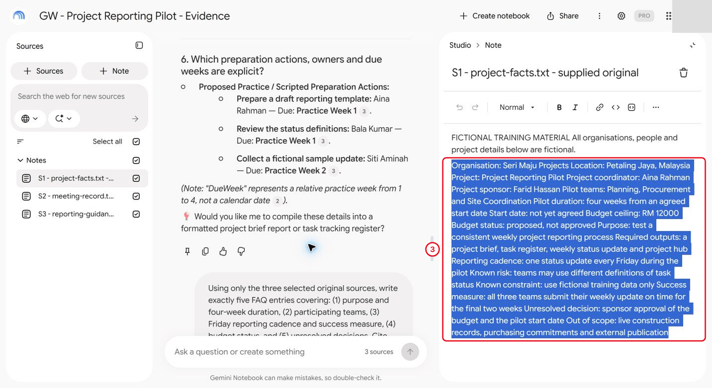

*Read the surrounding text, not just the marker.*

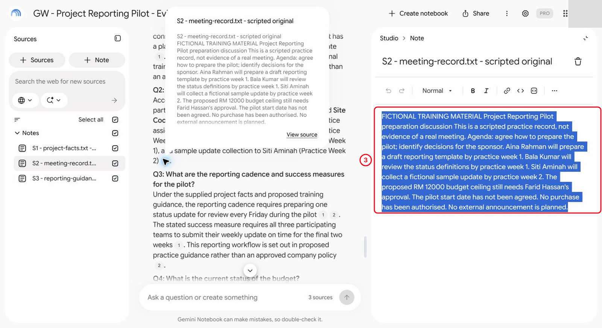

*S2 is the source for the no-purchase statement.*

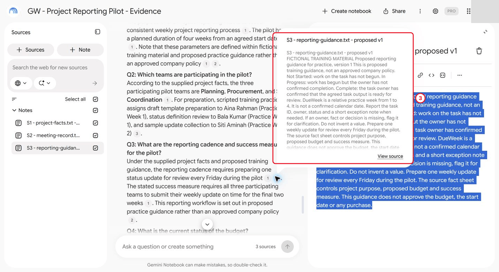

*The guidance supports the proposed Friday update, not approved policy.*

4. Create a note named **OUTPUT - Checked FAQ - training reference** and enter the corrected five-entry FAQ with source pointers. The observed interface automatically selects a newly created note as a source. Deselect this output note before generating media from the three originals; a saved answer does not become original evidence.

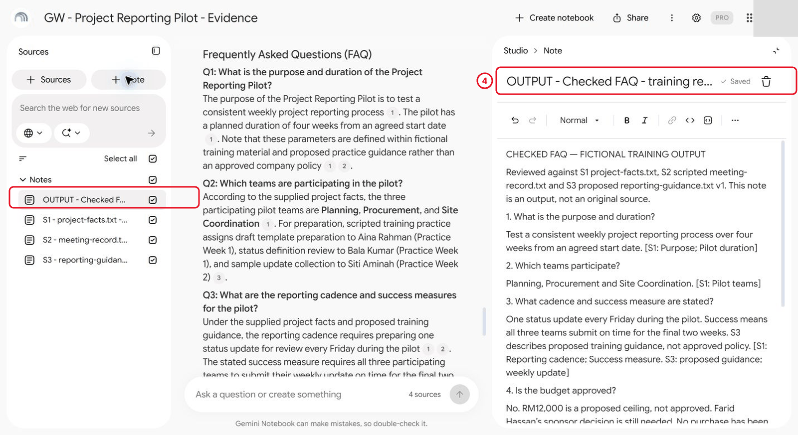

*A new note is selected as a source automatically. Deselect it before generating media.*

## 5.2 Generate an Audio Overview

1. Choose **Audio Overview** in Studio. In **Customise Audio Overview**, select **Brief**, keep **English**, inspect the **3 sources** selection and enter the source-bounded instructions from Part 4 of the prompts page. In the observed interface, the length choices disappeared after Brief was selected.

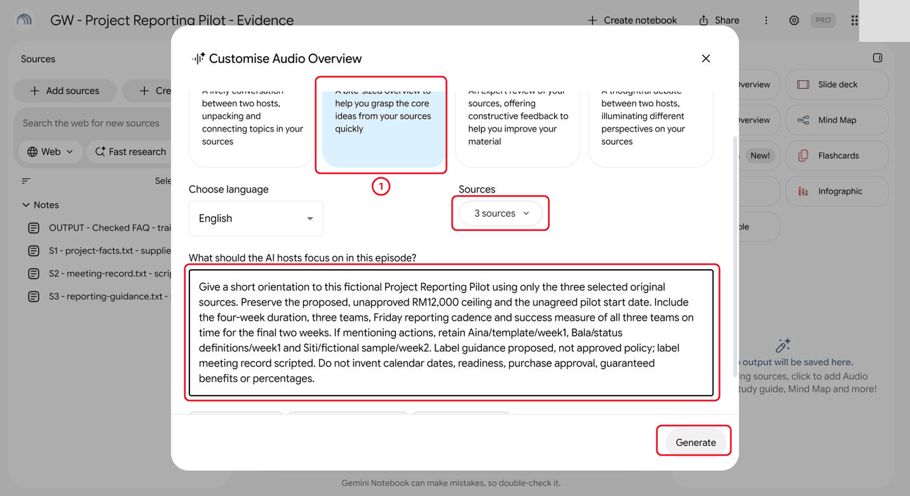

*Check the format, language and source count before Generate.*

2. Choose **Generate** once. Record generation time separately from active work. Notification permission is not required for this exercise.

> **Reference run:** The author prepared the written briefing and unscored audit sheet while generation was processing.

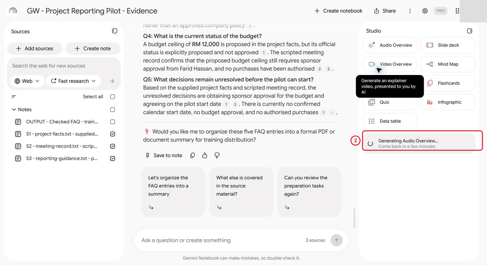

*Generation takes a few minutes. Record that wait separately from active work.*

3. The generated item was titled **Preparing the Seri Maju Reporting Pilot**, with duration **1:31**, format Brief and three sources. This confirms player operation, not factual review.

> **Reference run:** Opening it started playback; the displayed counter advanced to 00:05 before the author paused it.

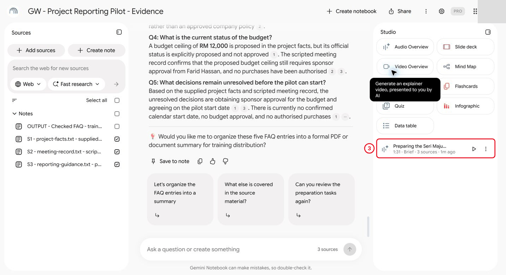

*A finished clip proves the player works, not that its content is accurate.*

## 5.3 Review the Audio Claims

1. Listen for claims about the proposed RM 12,000 ceiling, unagreed start, four-week duration, three teams, Friday cadence, final-two-week success measure, scripted actions and authority. Record approximate timestamps, the actual claim, source passage and verdict.
2. If listening fails (for example a download error), record the failure, keep every claim row **Not tested** and say so in your manifest.

> **Reference run:** author decision (29 October 2026): listening and timestamped checks were skipped at the instructor’s request after both author and instructor encountered the 403 failure. This does not establish a service-wide outage. Audio generation and initial playback were observed, but substantive listening and timestamped claim checks remain incomplete. The download action opened a Google 403 Forbidden page and browser control disconnected. No audio claim is marked supported merely because generation completed. The written source checks do not establish the contents of the generated clip.
3. Keep the checked written briefing as the maintained handover while media review is pending. Retain the audio as **Generated — review pending**; do not label it reviewed or externally distribute it during this exercise.

## 5.4 Create a Briefing Package and Audit Generated Media

1. Create a Google Doc named **GW - AI - Checked Briefing Package** with the headings **Purpose**, **Known facts**, **Open decisions** and **Next checks**. Use the checked FAQ and original source pointers. Preserve the budget/date caveats and distinguish relative practice weeks from calendar dates.

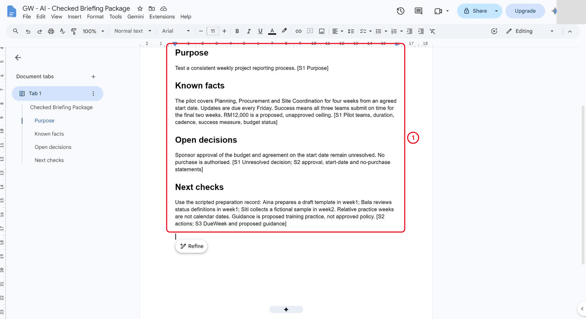

*The written briefing is the maintained, checked text.*

2. In the same Doc add the fallback script from Part 5 of the prompts page and a claim-audit table headed **Claim-audit sheet - awaiting media review**, with columns Topic, Time / claim, Source check and Verdict. Before listening, leave timestamp/claim cells **Not yet reviewed** and verdicts **Not tested**. The script has a 60-second target; its reading duration has not been measured.

> **Reference run:** The author table has six topics plus its header.

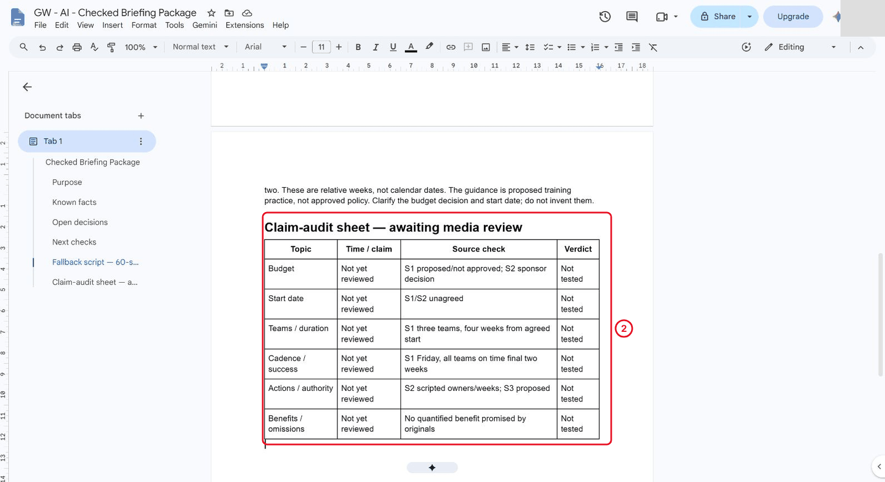

*Leave the rows unscored until you have actually listened.*

3. Once listening is complete, replace the placeholders with the actual claims and approximate timestamps. Compare media with the written briefing for budget/date caveats, actors, cadence, success measure and omissions. Audit every substantive claim; do not manufacture six claims just to fill a template.
4. If Audio Overview is unavailable in your account, use the flawed practice script in Part 1 of the prompts page, label that script route and retain audio generation/playback as untested.

> **Reference run:** Audio generation was available, so a script audit cannot be presented as a review of the generated clip.
5. Keep an output manifest: checked FAQ note and written briefing are maintained text; the generated overview is an output snapshot with its actual source selection and review status. Independent comprehension testing and reviewer agreement are still pending.

> **Reference run:** The author's current media status is **Generated — review pending**.

> **Reference run:** author-run scope: five FAQ entries and original passages checked, corrected output note saved and deselected, Brief audio generated from three originals, initial playback counter verified, written briefing and unscored audit table saved. Audio download failed; full listening, timestamped verdicts, independent challenge, human review and classroom timing remain pending.

## Independent Practice

Close the earlier step lists for the first attempt. Use the case input and your own reasoning. If you need help, record the hint and repeat the affected check independently.

1. Write a fresh 60-second briefing script independently and have a partner identify the two open project decisions from it.

2. Correct an ambiguity and compare the revised script with the source. Record which claims were checked and which generated-media features were unavailable.

3. Prepare a manifest for written FAQ, checked script and generated audio/fallback. State which is the maintained checked text and which is an output snapshot.

### Evidence to Hand Over

- Written briefing, claim/timestamp audit and source-based verdicts.
- Checked fallback script and comprehension test with a targeted revision.
- Output manifest with honest media-generation and review status.

Record the defect or uncertainty you investigated, the evidence used, the repair or reasoned no-change decision, and the final state. Restore temporary changes or keep them in a clearly named scenario copy.

## Troubleshooting

| Symptom | What to check |
|---|---|
| Audio sounds fluent but omits open decisions | Use the required-fact checklist and a checked written fallback instead of judging tone alone. |
| An input or earlier result is missing | Reopen the input named in Before You Begin; do not substitute private company data |
| A menu or feature is unavailable | Confirm the account and the shared access notes; record the missing step and ask the trainer for its fallback |
| The result differs from the checkpoint | Compare the exact source range, wording and conditions before repeating the action |

## Lesson Summary

Checked text and audio both need factual review. **Check yourself:** Which claim would you verify first?
