# 07 - Run an AI Pilot

In this chapter you will apply a repeatable prompt workflow to a small task and compare the checked result with a manual baseline.

> **Prompts and values:** use the [copy-paste page](./prompts.md) for the exact values used below.

**Target allocation:** 50 minutes: 10 explanation/demonstration, 20 guided build and casework, 15 independent challenge, 5 verification and repair. The active portion is 40 minutes by design. These are unmeasured targets awaiting a learner pilot.

**Your result:** A supervised pilot with checked outputs and a transparent timing comparison.

> **Status:** guided author reference with 15 staged captures. Predefined rubric, checked A/B attempts and a targeted author rerun are recorded. Human manual baseline, complete active-effort timing, independent challenge, reviewer agreement and classroom timing remain unvalidated.

## What You Will Learn

- Define a small repeatable task.
- Compare manual and AI-assisted work fairly.
- Measure the checked outcome rather than raw speed.

## Before You Begin

Read the [case input](./prompts.md) and use a separate named casework copy for destructive tests or altered datasets. Keep the baseline unchanged for later chapters. Record source facts, proposed practice and unresolved questions separately.

Use the fictional source pack and review log. This is a supervised manual workflow, not a deployed unattended automation.

## 7.1 Define the Pilot

1. Create `GW - AI - Pilot Evaluation`. Use the same three original fictional sources for every attempt. Set the acceptance rule before generation: all five topics pass, each consequential claim has source support, and no approval, date, supplier or gain is invented.
2. Use the copy-paste page's rubric. The date criterion includes both the unagreed calendar start and the unresolved sponsor decision. Record prior familiarity and attempt order. A rejected first draft is not an accepted output.
3. A participant should first write and check a manual FAQ, logging drafting and checking separately. **Author boundary:** this reference was prepared by an AI agent with extensive source familiarity. Its source-based reference is not a human manual baseline. Human manual and classroom timings remain unmeasured; no productivity percentage can be calculated.

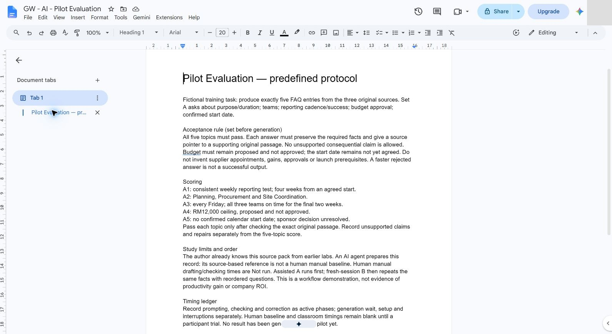

## 7.2 Run the Assisted Attempt

1. Open a fresh Gemini conversation in the approved account. Record the visible mode; the author used Flash. Paste the common brief, Set A questions and all three labelled originals. Do not paste only the question list.

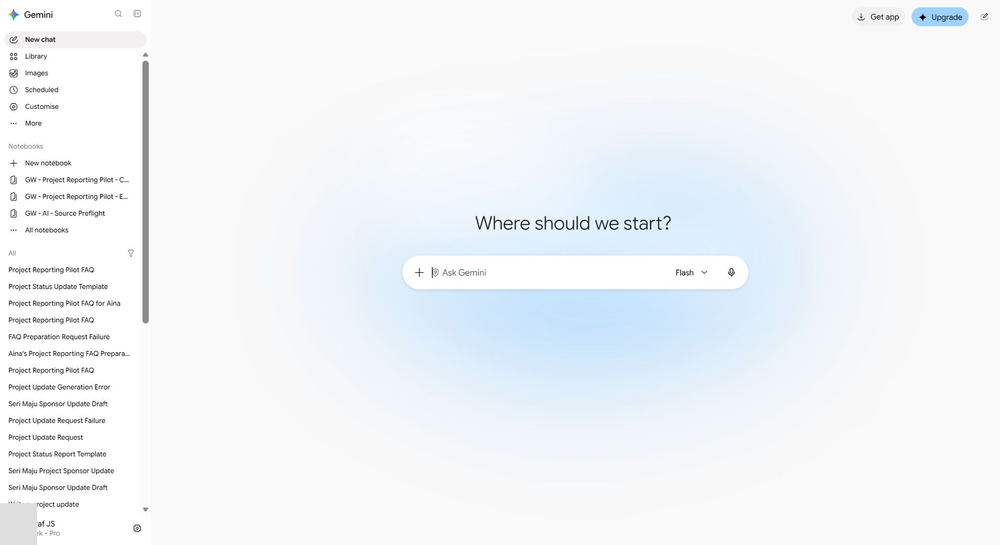

2. Submit once and record generation waiting separately. While waiting, retain the expected source facts and a clearly unscored ledger. The author reference below is a source check, not a timed human attempt.

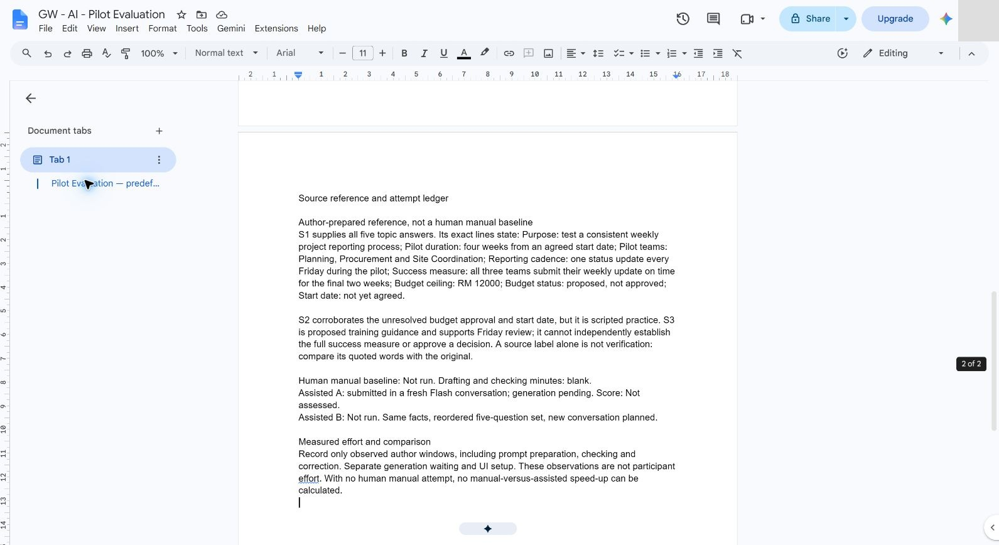

3. Read the complete response before scoring. The observed Set A used five extractive entries with S1 quotes. A source label is only a pointer: compare the quoted passage with the actual original.

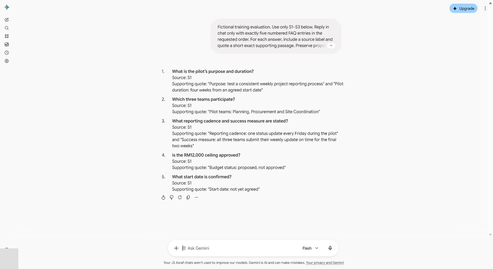

## 7.3 Evaluate the Outcome

1. Apply the predefined rubric without changing it after seeing the response. Set A preserved the purpose/duration, teams, cadence/success and budget status. Its date quote retained “not yet agreed” but omitted the unresolved sponsor-decision statement required by the scorecard: **4/5, repair required**. This is an omission against that contract, not an invented date.
2. Record the author correction: retain A1–A4 and replace A5 with the no-agreed-date statement plus S1's exact unresolved-decision line. Recheck the corrected reference: **5/5**. Keep the original model response and distinguish the author's repair from a regenerated answer.

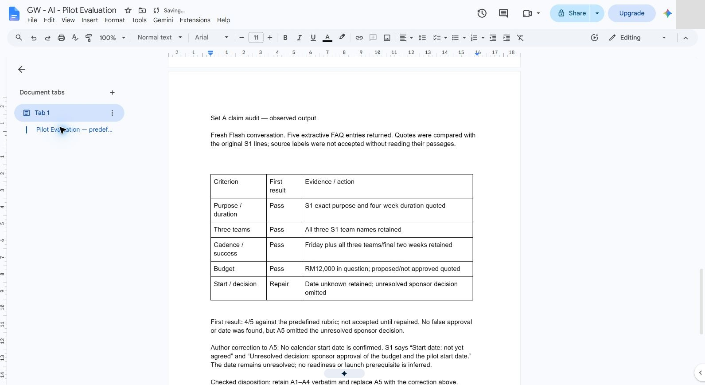

3. Include prompting, source checking and repair in active effort. Keep generation wait, sign-in, setup and interruptions separate. The author observed Set A complete within about 98 seconds of submission; that interval included other work and is an upper bound, not exact server latency or human effort. Complete human timing is still required before a manual/assisted comparison.

## 7.4 Run a Small, Interpretable AI Evaluation

1. Start a fresh conversation and paste Set B with the unchanged brief, mode and source pack. It asks the same five questions in a different order: budget, date, cadence/success, teams, purpose/duration. This is a reordered repeat, not an unseen task or a human baseline. Keep attempt order and familiarity visible.

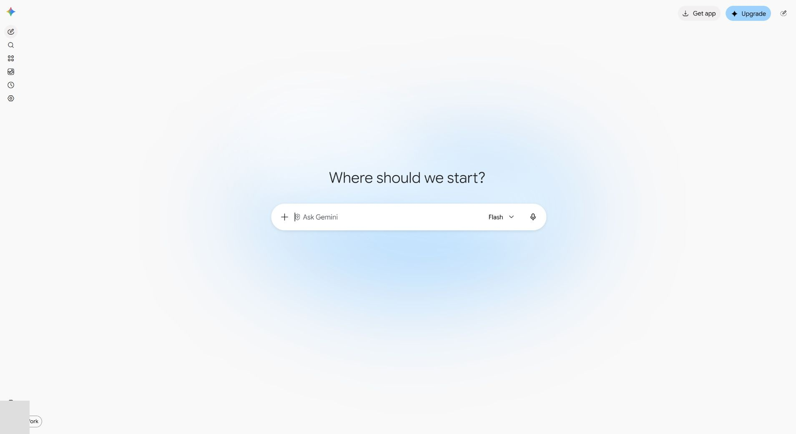

2. Record a design issue before the repair trial: the original visible date question did not explicitly ask for every scorecard detail. The score remains recorded, but do not blame the omission solely on the model. Keep A and B unchanged; prepare the explicit acceptance-check block for a separate Set A rerun C.

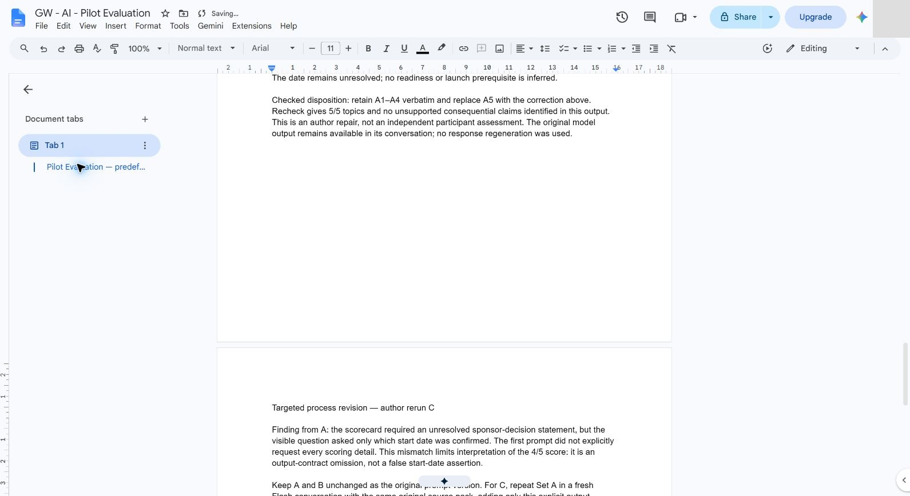

3. Inspect the entire Set B answer and its original supporting passages, including facts beyond its short excerpts. It retained the unapproved budget, sponsor identity and unresolved date/decision, plus all other required facts. First-review result: **5/5; no correction needed**. Do not infer that reordering caused the difference.

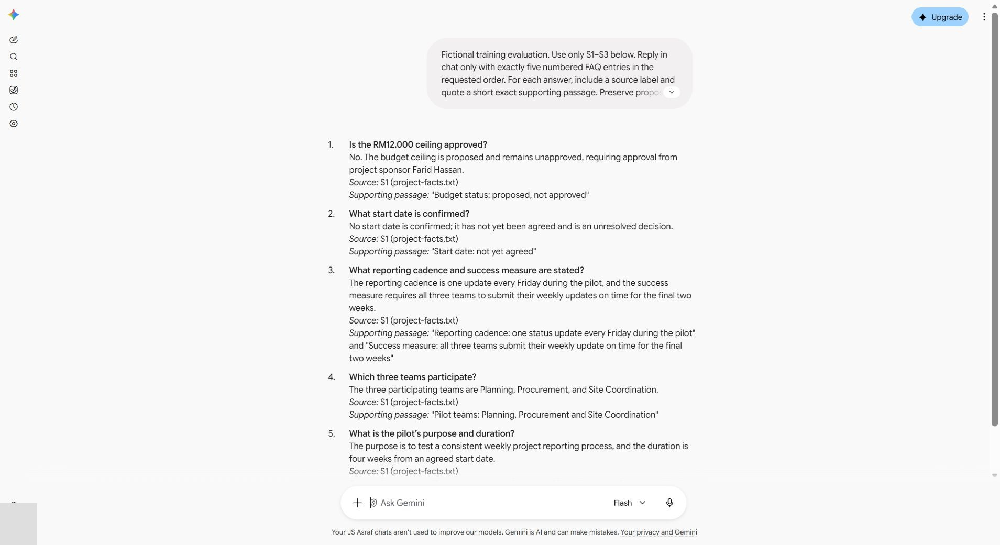

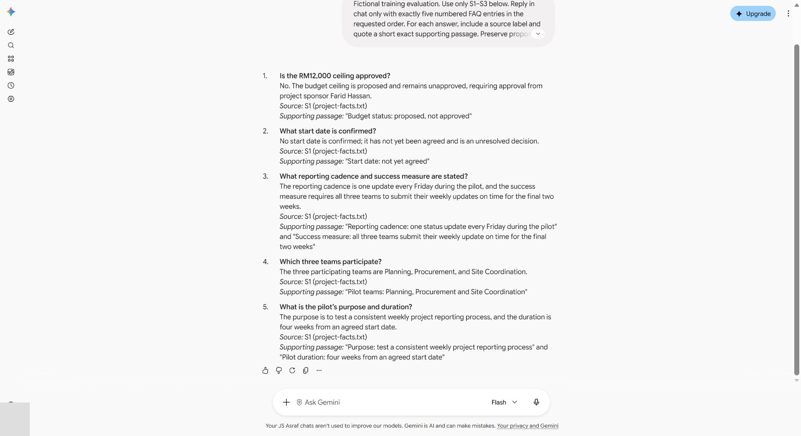

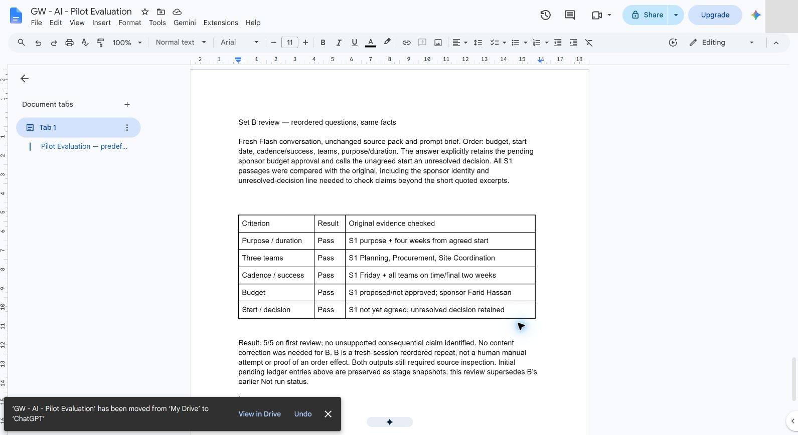

4. Run C in another fresh Flash conversation using Set A and the same sources, adding only the explicit output acceptance block. Apply the same rubric when a complete answer exists. In the author run C remained generating after more than seven minutes, then returned to the new-chat composer with the prompt restored and no answer. No cause was established and no retry was submitted. Keep C unscored; this does not demonstrate a successful repair. This is an author repair attempt, not an independent learner challenge.

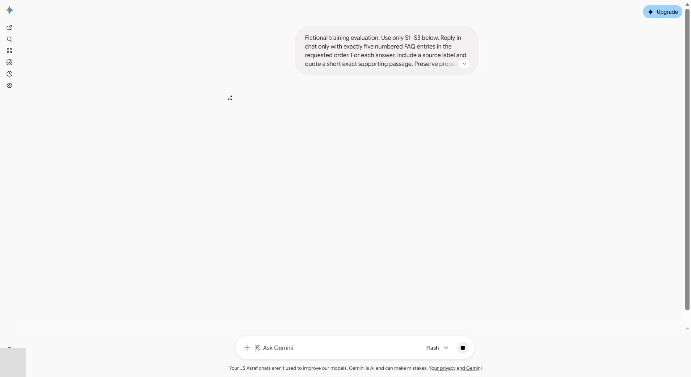

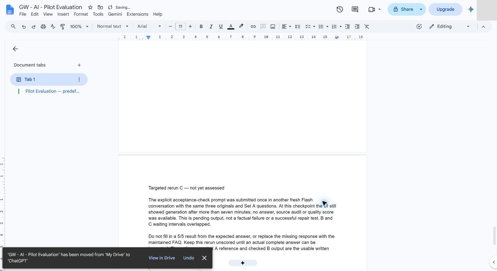

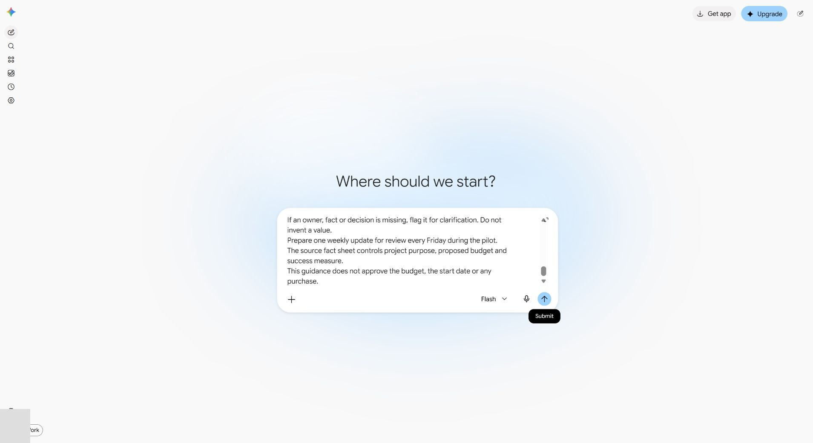

5. Save the final review and timing ledger. Report the actual sample size, prompt-contract mismatch, order/familiarity effects and unmeasured phases. B and C generation waits overlapped; do not add those intervals as sequential task duration. A complete participant comparison must include all active drafting, prompting, checking and correction for each accepted output. The maintained FAQ below is author-checked text, not a substitute for C's missing response.

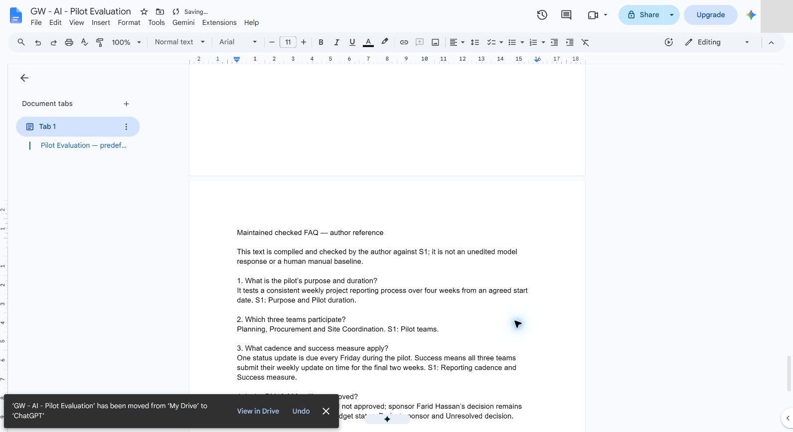

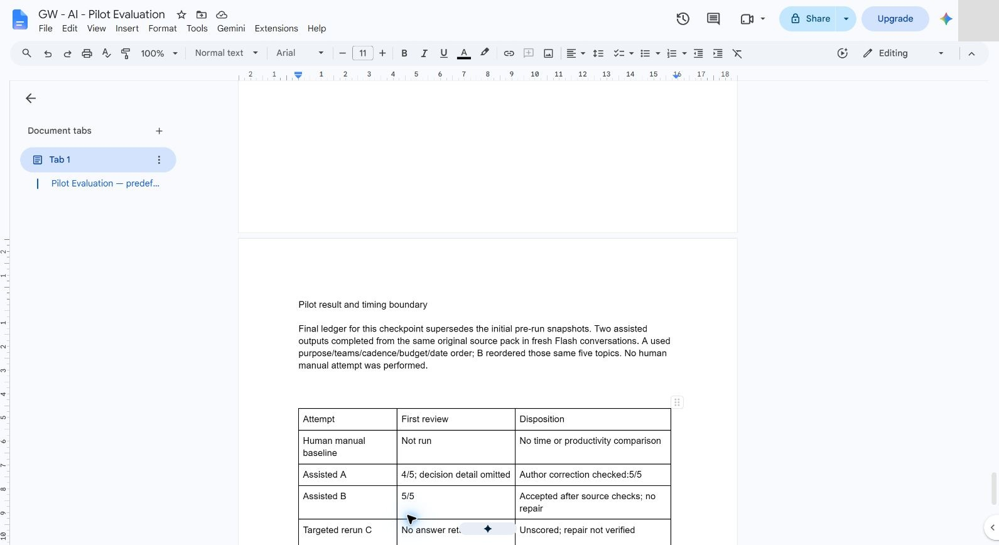

6. Recommend a narrow next trial: have a participant complete the aligned manual and assisted tasks using the same sources and acceptance rule, with phase timing and reviewer checks. Repeat on an equivalent task with a different order. Keep the checked outputs, defects and repairs; avoid company-wide ROI claims from this demonstration.

See the [author results and maintained FAQ](./author-reference.md).

## Independent Challenge

Close the earlier step lists for the first attempt. Use the case input and your own reasoning. If you need help, record the hint and repeat the affected check independently.

1. Independently revise the prompt or review process based on the first results and rerun one previously failed case.

2. Show whether quality improved and what extra checking effort was required. If no failure occurred, test a missing-fact or conflicting-source case.

3. Recommend one narrowly defined next trial and specify the evidence required before changing a real workflow.

## Evidence to Hand Over

- Predefined acceptance rubric and comparable manual/assisted attempts.
- Timing ledger separating active effort, wait and rework, with quality scores.
- Independent process revision, rerun and bounded next-trial recommendation.

Record the defect or uncertainty you investigated, the evidence used, the repair or reasoned no-change decision, and the final state. Restore temporary changes or keep them in a clearly named scenario copy.

## Troubleshooting

| Symptom | What to check |
|---|---|
| A time-saving claim excludes review effort | Compare accepted outputs and include prompting, checking and correction as active work. |
| An input or earlier result is missing | Reopen the input named in Before You Begin; do not substitute private company data |
| A menu or feature is unavailable | Confirm the account and the shared access notes; record the missing step and ask the trainer for its fallback |
| The result differs from the checkpoint | Compare the exact source range, wording and conditions before repeating the action |

## Lesson Summary

A useful AI pilot measures a checked workflow under stated conditions.

**Check yourself:** Which review work must be included in the assisted task time?
