# 08 - Share the Prompt Playbook

In this chapter you will explain the workflow, review criteria, time observations and limits.

> **Prompts:** the [prompts page](./prompts.md) has every value and prompt for this chapter, each with a Copy button.

**Estimated time:** 40 minutes, planned as 10 explanation and demonstration, 10 guided build and casework, 15 independent practice and 5 verification and repair, with 30 active minutes by design. Not yet timed with learners.

**Your result:** A reusable, tested prompt playbook and short handover.

> **Status:** author reference with 17 staged captures. Version 1.1 source assembly was retested in a fresh session; the returned FAQ passed five factual checks and its maintained copy repairs list numbering. Partner reproduction, independent challenge, spoken handover, human effort and classroom timing remain unvalidated.

---

## What You Will Learn

- Package a reusable prompt with its checks.
- Explain the source and access requirements.
- Demonstrate a complete handover.

## Before You Begin

Read the [case input](./prompts.md) and use a separate named casework copy for destructive tests or altered datasets. Keep the baseline unchanged for later chapters. Record source facts, proposed practice and unresolved questions separately.

Use the checked FAQ, evidence review and pilot timing record. Keep the playbook in your practice workspace.

## 8.1 Build the Playbook

1. In **GW - AI - Practice** create a Google Doc named `GW - AI - Prompt Playbook` with the headings Task, Input Sources, Prompt, Review Checks, Output and Known Limits. Keep the first draft and current version distinguishable. The task is a five-topic FAQ, not an unattended automation.

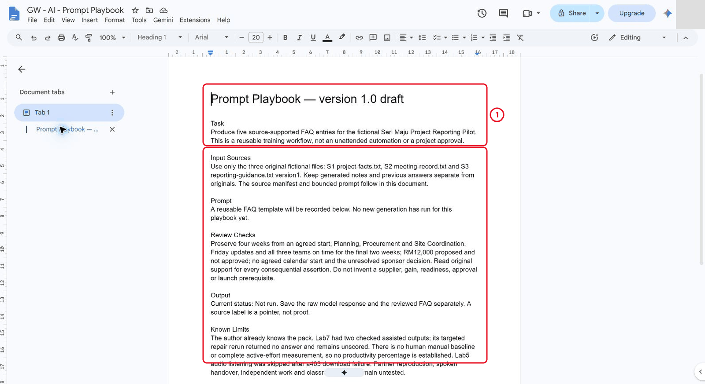

*The playbook starts as a draft. Nothing has been generated yet.*

2. Add the three-original-source manifest and account/feature preflight. S1 controls project facts; S2 is scripted practice; S3 is proposed guidance. Use fictional data and the trainer-approved account. Record the visible mode without assuming every learner has the same features.

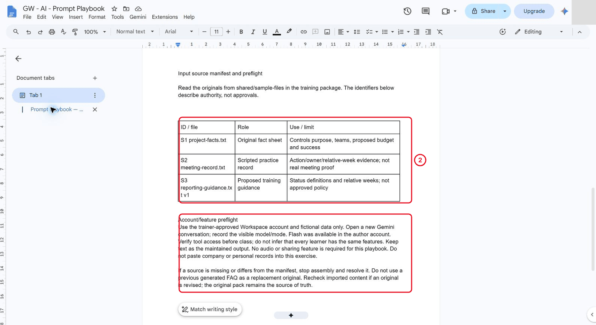

*S1 controls the facts; S2 is scripted and S3 is proposed.*

3. Add the exact bounded prompt from Part 2 of the [prompts page](./prompts.md) and the acceptance rule. Preserve the agreed-start qualification, all teams, Friday/final-two-week success measure, proposed/unapproved RM 12,000 ceiling and unresolved date/sponsor decision. Source slots in a reusable template must be replaced before submission.

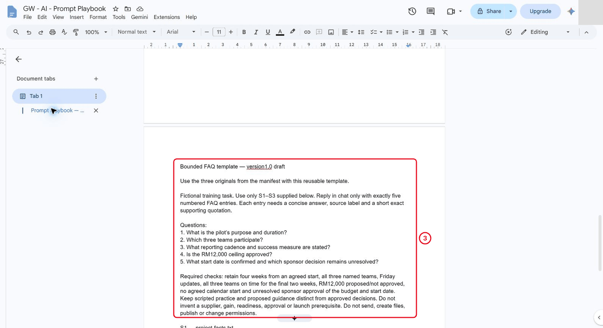

*The template still has source slots to fill before sending.*

## 8.2 Test Another Run

1. Open a fresh conversation using only the documented pack. As a controlled preflight case, inspect the draft template with its unfilled slots. This is not a failed model answer or a human comprehension test.

> **Reference run:** The author stopped before Send because the literal source slots were still present.

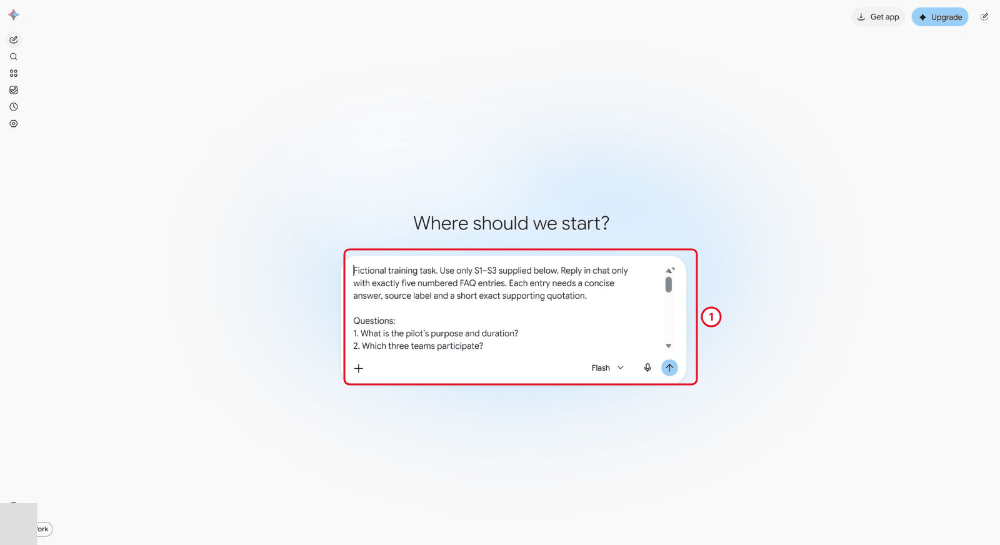

*Stop before Send: the [PASTE_] slots haven't been replaced.*

2. Revise the instructions to version 1.1: name the three files and their supplied folder; paste each complete original text into its corresponding slot; retain source labels; require zero `[PASTE_` slots before Send. A filename or an old generated FAQ does not supply the original text.

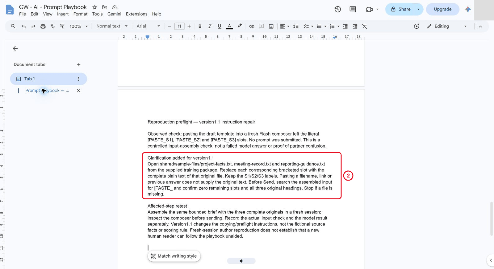

*The repair is to the instructions, not to the sources.*

3. Retest the affected assembly step. Confirm all three full originals appear in the actual input and that no slot remains. The final input matched the intended prompt after whitespace normalisation. This was an automation-input repair, not a source defect.

> **Reference run:** The author caught a mixed old/new composer input, cleared it and repasted before any Send.

*Check the actual input contains all three originals before sending.*

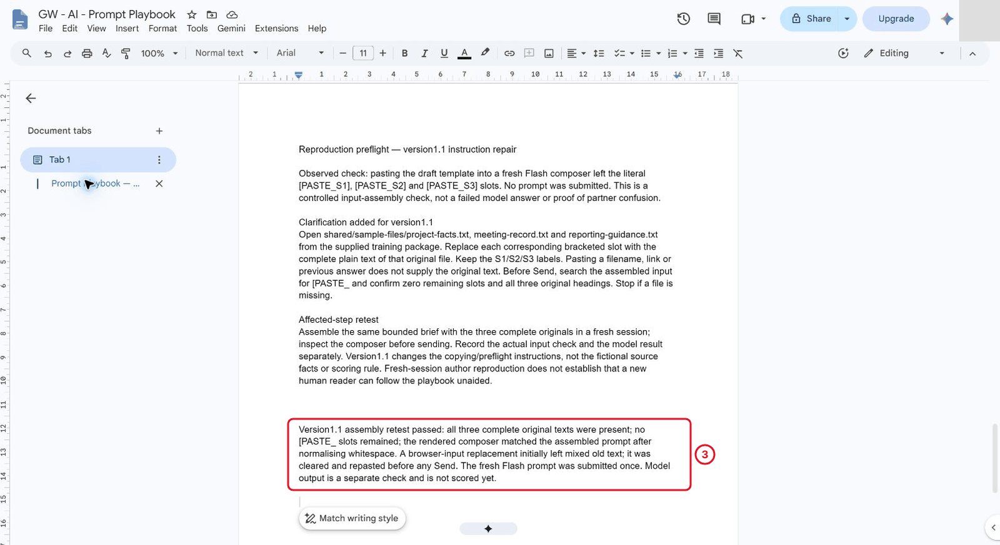

*The retest checks the affected step, not answer quality.*

4. Submit once in the recorded mode and retain the actual response separately from the maintained reference. A correct preflight does not prove answer quality. Review all five topics and original passages before accepting the result; an absent answer receives no factual score.

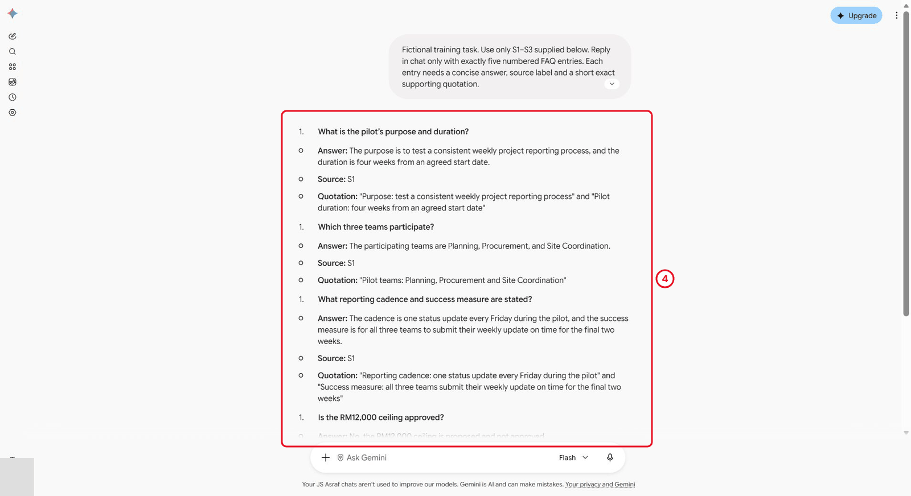

*Review all five topics against the originals before accepting.*

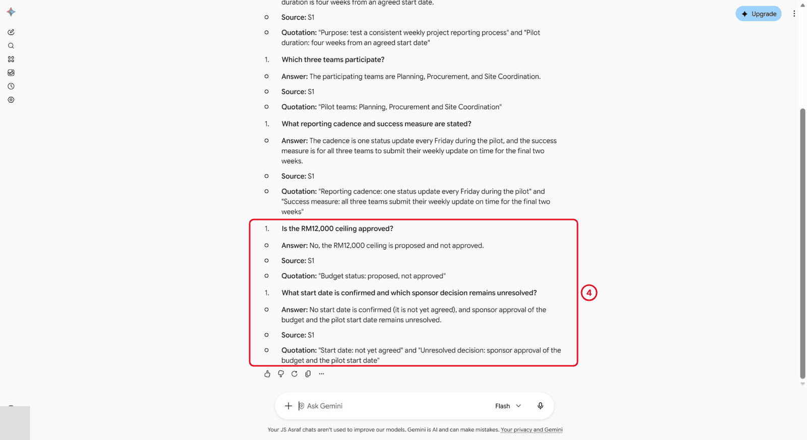

*Budget stays proposed and the start date unresolved.*

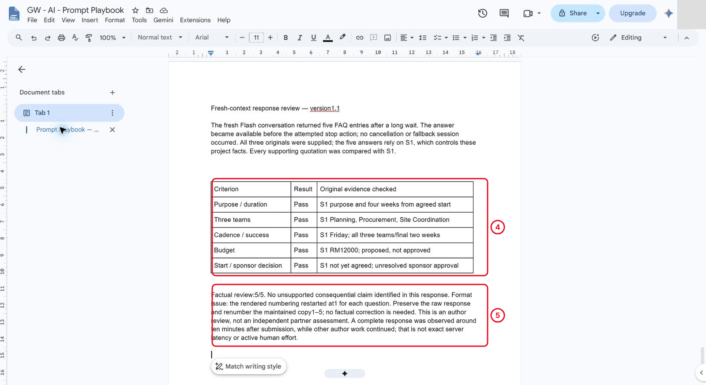

*The numbering fix is a format repair, not a factual correction.*

5. Score the five factual topics. If the rendered list numbering is wrong, keep the raw response unchanged and repair only the maintained copy's numbering; that's a formatting repair, not a factual correction.

> **Reference run:** the fresh author response preserved all five factual topics and their S1 support (5/5 factual checks). Its rendered list restarted at 1 for each question, so the maintained copy was renumbered 1–5. The answer arrived during the final wait check, so no cancellation or alternative session took place. The long observation interval is not a measured productivity gain.

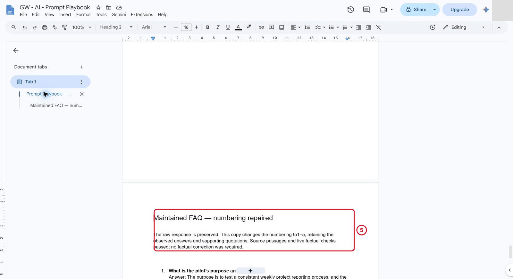

*The raw response stays unchanged; only this copy is renumbered.*

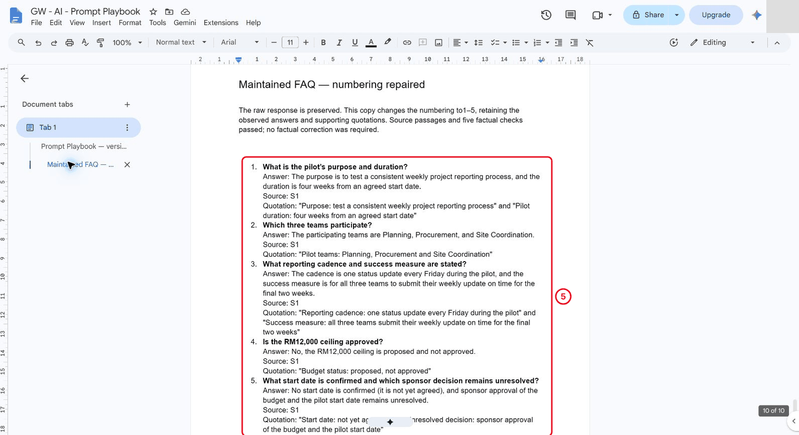

*Five numbered answers, each with its source and quotation.*

## 8.3 Present the Handover

1. Prepare a two-minute explanation of the task, source roles, fresh-session inputs, source checks and checked output. Include the prompt-contract mismatch and incomplete rerun from the earlier pilot without claiming a measured productivity benefit.
2. Name the next narrow participant trial: aligned manual/assisted tasks with complete phase timing and a reviewer.

> **Reference run:** The author prepared the written script below; spoken delivery and the two-minute target remain unmeasured. Class discussion and distribution require an actual approved channel and have not occurred in this author run.

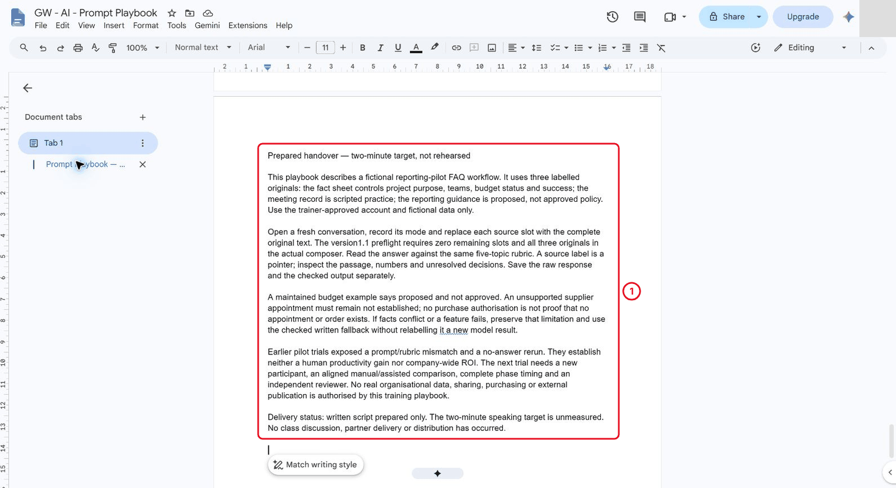

*The script is written. Spoken timing is still unmeasured.*

## 8.4 Make a Playbook Another User Can Reproduce

1. Include concrete recovery instructions for missing facts, conflicting source roles/versions, stale imported text, unavailable audio and a no-answer run. Preserve a failed or missing output as unscored. Keep checked text as the fallback; do not call it a new generated answer.

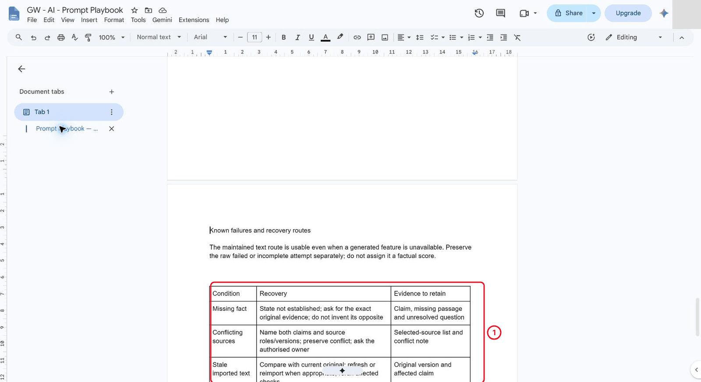

*Each failure route says what to do and what evidence to keep.*

2. Include an accepted maintained example and a clearly rejected claim with the exact source reason. Supplier appointment and PO issuance are not established by the pack. “No purchase authorised” does not prove that no appointment or unauthorised order exists. Do not invent the opposite of an unsupported claim.

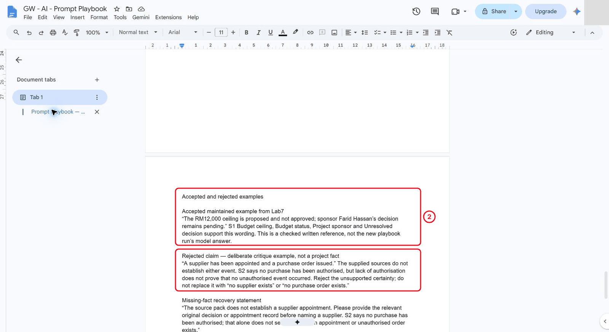

*The rejected claim isn't replaced with an invented opposite.*

3. Keep a handover manifest: originals and roles, source hashes, prompt version, raw response, reviewed output, review evidence, known failures and remaining checks. Keep account-specific URLs in private trainer notes. The self-contained [version 1.1 prompt](./faq-prompt-v1.1.txt) contains the three originals; [source hashes](./source-manifest-v1.1.json) identify its input snapshot. Reassemble it if an original changes.

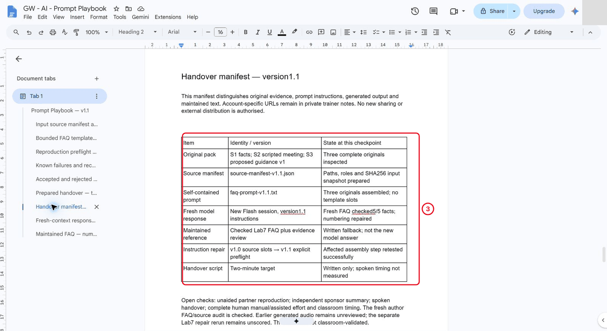

*The manifest separates originals, prompt, raw response and checked output.*

[Open the current version 1.1 playbook overview](./images/c06-08-15-current-playbook-release.png).

4. Retain the version 1.1 instruction repair and actual fresh-context result. The [playbook reference](./playbook-v1.1.md) records the usable method and remaining limits. This is author reproduction with prior familiarity; partner reproducibility, independent learner work, spoken delivery and classroom timing remain separate checks.

## Independent Practice

Close the earlier step lists for the first attempt. Use the case input and your own reasoning. If you need help, record the hint and repeat the affected check independently.

1. Use the independent handover brief to produce a sponsor summary in a fresh context without the original chat history.

2. Audit it against the same factual invariants and demonstrate the missing-fact recovery procedure.

3. Give a two-minute explanation of the method, observed benefit/limitation and next small test. Hand over the versioned playbook and evidence manifest.

### Evidence to Hand Over

- Versioned playbook with exact input and review/recovery instructions.
- Fresh-context reproduction and recorded instruction repair or edge-case test.
- Independent sponsor summary with source audit and a complete handover manifest.

Record the defect or uncertainty you investigated, the evidence used, the repair or reasoned no-change decision, and the final state. Restore temporary changes or keep them in a clearly named scenario copy.

## Troubleshooting

| Symptom | What to check |
|---|---|
| The playbook only works inside the author’s old conversation | Specify fresh-session inputs and rerun using only the documented sources and prompt. |
| An input or earlier result is missing | Reopen the input named in Before You Begin; do not substitute private company data |
| A menu or feature is unavailable | Confirm the account and the shared access notes; record the missing step and ask the trainer for its fallback |
| The result differs from the checkpoint | Compare the exact source range, wording and conditions before repeating the action |

**Lesson summary:** Carry a bounded, checked AI workflow into an approved workplace setting. **Check yourself:** Could another person tell whether an answer is unsupported using your playbook?
