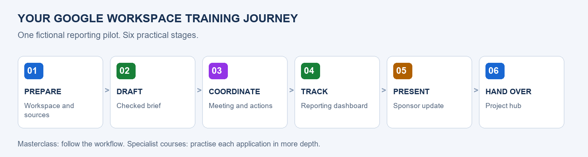

# Google Workspace Training Programme

Participant lab drafts, practice files and review books for six Google Workspace courses, organised in one repository.

You do not need a GitHub account to read the materials.

**Version 0.4**, last updated 21 October 2026.

The programme now has 50 draft chapters: six expanded masterclass labs and 44 expanded specialist labs. The package includes a shared participant site, practice files and six review books. Masterclass Labs 1–6, Docs Labs 1-8, Slides Labs 1-8 and Sheets Foundation Labs 1–8 and Advanced Labs 1–11 now have 1,039 staged real-app images, with limitations recorded per lab. The hub Preview remains blocked; remaining specialist routes, independent challenges and learner timing pilots are still required. See the [validation status](./planning/VALIDATION-STATUS.md).

## Program Flow

The masterclass follows the whole reporting workflow. The five specialist courses provide deeper practice with the same fictional organisation. Each specialist course starts with its own input files, so it can be taught independently.

## How to Use This Site

Choose a course below, then open its numbered chapter notes. Each chapter has click-by-click steps and a separate **Prompts and values** page with text you can copy into the application. On the course website, use the Copy button beside a text block; on GitHub, use the block's copy icon.

Download [all course files (ZIP)](https://github.com/Asraf-JS/Google-Workspace/archive/refs/heads/main.zip), then extract the ZIP before opening any file. The six PDF books below are review drafts for offline reading or printing. The [practice files ZIP](./shared/practice-files.zip) contains just the supplied exercise inputs.

## Courses and Books

| # | Course | Duration | Review book | Current material |
|---|---|---|---|---|
| 1 | [Collaborative Tools Masterclass](./01-collaborative-tools/README.md) | 1 day | [PDF](./books/01-collaborative-tools-Book.pdf) | 6 labs; 109 captures, hub Preview pending |
| 2 | [Google Docs](./02-google-docs/README.md) | 1 day | [PDF](./books/02-google-docs-Book.pdf) | 8 labs; 165 captures in Labs 1-8 |
| 3 | [Google Slides](./03-google-slides/README.md) | 1 day | [PDF](./books/03-google-slides-Book.pdf) | 8 labs; 173 captures in Labs 1-8 (Lab 2 imports, spoken delivery, reviewer and interactive PDF checks pending; independent/human validation remains) |
| 4 | [Google Sheets Fundamental and Intermediate](./04-sheets-foundation-intermediate/README.md) | 1 day | [PDF](./books/04-sheets-foundation-intermediate-Book.pdf) | 8 labs; 213 captures across Labs 1–8; CSV import, values-only format, independent/human and learner-timing checks pending |
| 5 | [Google Sheets Advanced](./05-sheets-advanced/README.md) | 2 days | [PDF](./books/05-sheets-advanced-Book.pdf) | 12 labs; 379 captures in Labs 1–11; Lab 12, independent/reviewer and learner timing pending |
| 6 | [NotebookLM and Gemini](./06-notebooklm-gemini/README.md) | 1 day | [PDF](./books/06-notebooklm-gemini-Book.pdf) | 8 written labs; captures pending |

## Course Scenario

> You are a project coordinator at the fictional Seri Maju Projects in Petaling Jaya. Your team is piloting a consistent project reporting process. You need a checked brief, reliable register, clear updates and one place to find project information.

All names, organisations and records in the practice material are fictional. The scenario does not describe GAMUDA or a real client project.

| Stage | What happens |
|---|---|
| Prepare | Organise files, check sources and plan access |
| Draft | Write and review a factual project brief |
| Coordinate | Turn the meeting record into accountable actions |
| Track | Clean the register and calculate a reporting dashboard |
| Present | Build a sponsor update from checked evidence |
| Hand over | Assemble the project hub and check its dependencies |

## Sample Data

Use the [practice pack](./shared/sample-files/README.md), including the fact sheet, starter task register, order dataset and source texts. Trainer answer keys are distributed separately.

Download the [practice files ZIP](./shared/practice-files.zip), save it and extract it before opening the files.

## Before You Start

Use an account approved by your trainer. Check the [access requirements](./planning/ACCESS-AND-FEATURES.md). Work only with fictional samples. Inviting people, sending messages and publishing a site are separate classroom actions agreed with the trainer.

## What to Learn Next

- [Google Workspace Learning Center](https://support.google.com/a/users/)
- [Google Docs Editors Help](https://support.google.com/docs/)
- [NotebookLM Help](https://support.google.com/notebooklm/)

## Need Help

During the course, ask your trainer. For sign-in, licenses or organisation restrictions, contact your organisation's Workspace administrator.

*Last updated: October 2026 | Trainer: Asraf*

© Asraf Jaafar Sidik, Microsoft Certified Trainer. These materials are for course participants' personal use. Please do not redistribute or resell them.
